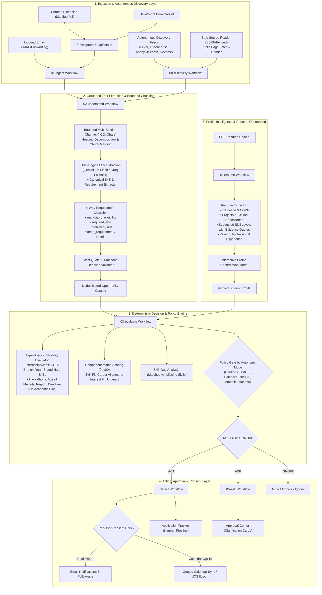

# OpportunityOS

> **The Autonomous Student Opportunity Intelligence & Action Operating System**  
> AI extracts grounded evidence; deterministic policy evaluates eligibility, enforces standing rules, and executes verified actions.

OpportunityOS is an autonomous agentic platform engineered to help students discover, evaluate, track, and act on **Internships**, **Jobs**, and **Hackathons** without missing deadlines, falling for predatory listings, or wasting hours on manual application spreadsheets. Built with **Next.js 15 App Router**, **Supabase PostgreSQL with strict Row-Level Security (RLS)**, **n8n workflow automation**, and a resilient **Dual-Engine AI architecture (Google Gemini + Groq LLM failover)**.

---

## Architecture Overview



---

## Core Pillars & Key Features

### 1. Three Focused Opportunity Categories
- **Internships**: Student-tailored work-experience opportunities with branch, degree, CGPA, and technical skill matching.
- **Jobs**: Full-time graduate roles, associate software engineer positions, and technical openings.
- **Hackathons**: Competitive team builds and coding events. Evaluated strictly on participation rules (legal age of majority, eligible countries/regions, verified submission deadlines) with **zero academic bias** (degree, branch, and CGPA are never used to disqualify hackathon participants).
- *Retired Categories*: Scholarship and Program categories have been retired per PRD specifications to maintain high-signal focus.

### 2. Autonomous Multi-Source Discovery
- **Zero-Auth Company Feeds**: Continuously scans Lever (CRED, Meesho), Greenhouse, and Ashby feeds.
- **Hackathon Registries**: Continuously scans Devpost for live developer hackathons.
- **Aggregated Feeds**: Integrated JSearch adapter for LinkedIn, Indeed, and Glassdoor searches.
- **Tiered Trust System**:
  - `corroborated`: Direct company career feeds.
  - `attributed`: Public aggregators and hackathon portals.
  - `unverified`: Flagged if upfront fees, suspicious compensation, or prompt-injection attempts are detected.

### 3. Automatic Full-Listing Reading & Bounded Extraction Pipeline
- **Automatic Page Fetching**: When structured API feeds lack full descriptions, OpportunityOS automatically fetches the specific public listing page using an SSRF-fenced reader.
- **SSRF Protection & Safety**:
  - Pinned DNS resolution with IPv4/IPv6 validation (internal, loopback, link-local, and private subnets are strictly blocked).
  - Enforces robots.txt compliance and transparent `OpportunityOS/0.2` User-Agent identification.
  - Redirect target validation (maximum 3 redirects, HTTPS-to-HTTP downgrade prevention).
  - Clean HTML-to-Markdown conversion that completely strips navigation, footers, aside menus, and advert scripts.
- **Bounded Multi-Section Chunking (>20,000 Chars)**:
  - Decomposes long-form job descriptions and hackathon guidelines (>20k characters) into semantic sections by headings without silent truncation.
  - Processes each section within bounded context windows and merges extracted skills and requirements with quote preservation.
  - Flexible retry heuristics re-examine non-bulleted requirements sections before falling back to `EXTRACTION_INCOMPLETE`.
- **Explicit Deadline & Timezone Recognition**:
  - Detects submission deadlines with exact times and timezones (e.g., `Oct 27, 2026 @ 1:00pm UTC` / `6:30 PM IST`, `2026-10-27T09:00:00-04:00`, `Nov 15, 2026 11:59pm IST`).
  - Distinguishes application submission deadlines from hackathon start dates, prize announcements, or page update timestamps.
- **4-Way Requirement Classification**:
  - `mandatory_eligibility`: Stated hard eligibility criteria (e.g., age of majority, country eligibility, explicit degree/batch years).
  - `required_skill`: Technical skills declared as mandatory in the requirements section.
  - `preferred_skill`: Skills marked optional or listed in "Nice to have" / "Good to have" sections.
  - `other_requirement` / `benefit`: Informational statements, perks, stipend, or prize amounts.

### 4. Deterministic Decision & Policy Engine
- **Three-Tier Policy Routing**:
  - `ACT`: High-confidence match meeting all mandatory requirements. Automatically queues permitted actions (calendar, tracker, alerts).
  - `ASK`: Ambiguous requirements, unstated facts requiring clarification, or borderline match scores. Surfaces interactive cards in the Approval Center.
  - `IGNORE`: Expired deadlines, failing mandatory constraints, or roles below the student's relevance threshold.
- **Non-Contradictory UI State**:
  - When facts are insufficient or eligibility is `UNKNOWN`, the system suppresses numerical scores and explicitly names the unresolved facts (e.g., *"The hackathon submission deadline is not stated"*), eliminating confusing `"Insufficient information to score"` badges displayed alongside numerical scores.
- **Configurable Autonomy Thresholds**:
  - `cautious`: Score $\ge 80$, Confidence $\ge 0.85$.
  - `balanced`: Score $\ge 70$, Confidence $\ge 0.75$.
  - `autopilot`: Score $\ge 60$, Confidence $\ge 0.65$.

### 5. Consent & Calendar Sync Architecture
- **Strictly Separated Consents**: Independent, granular database columns for `email_notifications_enabled` and `calendar_sync_enabled`.
- **Bidirectional Trigger Synchronization**: Database triggers synchronize consent preferences across UI actions, worker context, and notification dispatches.
- **Calendar Dispatch**: Google Calendar API integration writes events for opted-in demo accounts while providing universal `.ics` download links for all students.

### 6. Resume-First Onboarding
- **Comprehensive PDF Parsing**: Extracts degree, major, expected graduation year, CGPA, and years of professional experience.
- **Projects & GitHub Links**: Detects portfolio projects, descriptions, tech stacks, and source code links.
- **Evidence-Backed Skill Levels**: Proposes skill proficiencies (`Beginner`, `Intermediate`, `Advanced`) accompanied by verbatim resume quotes, allowing students to review and adjust before saving.
- **Privacy D9 Protocol**: Physical resume PDFs are automatically purged from storage upon profile confirmation.

### 7. Weekly Plan Retirement
- Per PRD specifications, the standalone Weekly Plan feature has been retired to streamline the user journey.
- `/plan` safely redirects to `/applications`, and `/api/plan/*` endpoints return HTTP 410 Gone (`FEATURE_RETIRED`), preserving historical task data without broken navigation.

---

## Technology Stack

| Layer | Technologies |
| :--- | :--- |
| **Frontend Web App** | Next.js 15 (App Router), React 19, TypeScript, Tailwind CSS, Lucide Icons |
| **Workflow Automation** | n8n (Self-hosted via Docker), Node.js Code Nodes, Custom HTTP Webhooks |
| **Database & Auth** | Supabase PostgreSQL, Row-Level Security (RLS), PL/pgSQL Triggers, Auth SSR |
| **AI & NLP** | Google Gemini 2.5 (`gemini-2.5-flash`), Groq Cloud (`llama-3.3-70b-versatile` / `gpt-oss-120b`) |
| **Browser Extension** | Chrome Extensions Manifest V3, Service Workers, Content Scripts |
| **Testing & CI** | Node.js Test Runner (`node --test`), Custom Behavioral Contracts, Smoke Test Suites |

---

## Repository Structure

```
OpportunityOS/
├── web/                             # Next.js 15 App Router web application
│   ├── src/app/                    # Pages: /inbox, /opportunities, /applications, /rules, /profile, /sources
│   ├── src/components/             # UI components: decision panels, opportunity cards, resume onboarding
│   └── src/lib/                    # Supabase SSR clients, validation schemas, decision contracts
├── workflows/                       # Sanitized, exportable n8n workflows
│   ├── 01-ingest.json              # Intake, hashing, and user authentication
│   ├── 02-understand.json          # Bounded extraction with dual Gemini/Groq LLM
│   ├── 03-evaluate.json            # Deterministic decision and semantic matching
│   ├── 04-act.json                 # Calendar scheduling, tracking, and notifications
│   ├── 05-ask-and-approve.json     # Interactive student approvals and clarifications
│   ├── 08-discovery.json           # Scheduled autonomous discovery feeder (Lever, Devpost, etc.)
│   └── 10-resume.json              # PDF resume parsing and profile alignment
├── scripts/                         # Pure-function contracts, test suites, and maintenance tools
│   ├── decision-contract.mjs       # Pure-function decision and eligibility logic
│   ├── discovery-adapters.mjs      # Normalizers for Lever, Greenhouse, Ashby, Devpost, JSearch
│   ├── safe-source.mjs             # SSRF-fenced public page fetcher with HTML-to-Markdown cleaning
│   ├── skill-extractor.mjs         # Multi-section chunking & canonical skill/requirement parser
│   ├── resume-contract.mjs         # PDF text sanitizer, project extractor, and skill level proposer
│   ├── smoke-tests.mjs             # Deployment smoke test suite (Slice S8)
│   ├── test-primary-acceptance-journey.mjs # End-to-end live primary acceptance journey
│   ├── run-database.ps1            # Database migration runner via n8n Postgres credentials
│   └── deploy-*-workflow.ps1       # Automated workflow import and activation scripts
├── supabase/
│   └── migrations/                 # Migrations 0001 through 0066 (RLS, schema, procedures, triggers)
├── extension/                       # Chrome Extension (Manifest V3)
│   ├── manifest.json               # Extension configuration
│   ├── popup.html / popup.js       # Extension UI for one-click capture
│   └── background.js               # Service worker for API dispatch
└── docs/                            # PRDs, architecture specifications, progress logs
```

---

## Getting Started

### 1. Prerequisites
- **Node.js**: v20.9.0 or higher
- **pnpm** or **npm**
- **Docker & Docker Compose**: For local n8n workflow execution
- **Supabase Account**: Cloud or self-hosted PostgreSQL database

### 2. Environment Configuration

Copy the example environment files and configure your keys:

```bash
# In the repository root
cp .env.example .env

# In the web directory
cp web/.env.example web/.env.local
```

Essential variables in `web/.env.local` and `.env`:
- `NEXT_PUBLIC_SUPABASE_URL`: Supabase project URL.
- `NEXT_PUBLIC_SUPABASE_PUBLISHABLE_KEY`: Supabase anon/publishable key.
- `N8N_PROJECT_ID`: n8n workspace project identifier.
- `RAPIDAPI_KEY`: (Optional) JSearch API key for aggregated job feeds.
- `GROQ_API_KEY`: (Optional) Groq Cloud key for ultra-fast fallback evaluation.

### 3. Database Migrations

Apply database migrations sequentially from `0001` through `0066` using your Supabase SQL editor or the provided database runner:

```powershell
powershell -ExecutionPolicy Bypass -File scripts/run-database.ps1 -SqlFile supabase/migrations/0001_foundation.sql
# ... sequentially through migration 0066
```

### 4. Workflow Deployment in n8n

Launch the n8n container and deploy workflows:

```bash
# Start n8n container
docker compose up -d

# Deploy active workflows
powershell -File scripts/deploy-discovery-workflow.ps1
powershell -File scripts/deploy-understand-workflow.ps1
powershell -File scripts/deploy-evaluate-workflow.ps1
```

### 5. Launch the Web Application

```bash
cd web
npm install
npm run build
npm start
```

Open [http://localhost:3000](http://localhost:3000) in your browser.

---

## Verification & Testing

OpportunityOS maintains a comprehensive test suite of 241+ unit and contract tests, 8 deployment smoke gates, and an end-to-end primary acceptance journey:

```bash
# 1. Run all core contract and unit tests (241 passing tests)
node --test scripts/*.test.mjs

# 2. Run the deployment smoke test suite (8 gates)
node scripts/smoke-tests.mjs

# 3. Run the live Primary Acceptance Journey
node scripts/test-primary-acceptance-journey.mjs

# 4. Compile the Next.js production build
npm --prefix web run build
```

---

## License

This project is licensed under the MIT License - see the [LICENSE](LICENSE) file for details.
