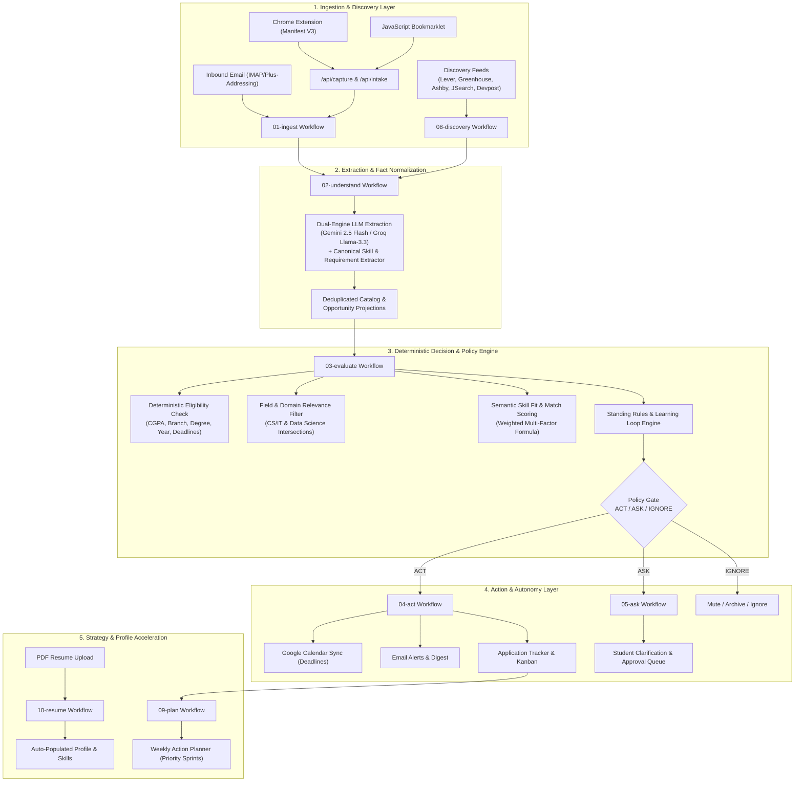

# OpportunityOS

> **The Autonomous Student Opportunity Intelligence & Action Operating System**  
> AI extracts grounded evidence; deterministic policy evaluates eligibility, enforces standing rules, and executes verified actions.

OpportunityOS is an autonomous agentic platform designed to help students discover, evaluate, track, and act on internships, hackathons, and research roles without missing deadlines or wasting hours on manual tracking. Built with **n8n workflow automation**, **Supabase PostgreSQL with strict Row-Level Security (RLS)**, **Next.js 15 App Router**, and a resilient **Dual-Engine AI architecture (Google Gemini + Groq LLM failover)**.

---

## Architecture Overview



---

## Key Features

### 1. Autonomous Multi-Source Discovery
- **Native ATS & Job Board Connectors**: Continuous autonomous discovery via Lever, Greenhouse, Ashby, JSearch (RapidAPI for LinkedIn/Indeed/Glassdoor), and Devpost.
- **Intelligent Field Relevance Filter**: Automatically filters non-technical roles (Sales, HR, Telecalling, Finance) for engineering students, while ensuring Data Science students receive both Data Science and core Computer Science opportunities.
- **Deduplication & Tiered Trust**: SHA-256 fingerprinting prevents repeated listings across feeds; risk signals flag non-standard compensation, upfront fees, or unverified claims.

### 2. Grounded Fact Extraction & Canonical Skill Recognition
- **Canonical Skill & Requirement Parser**: Recognizes over 80+ technology skills (HTML, CSS, JavaScript, React, Python, C/C++, Java, Android SDK, SQL, Docker, AWS, etc.) directly from job descriptions.
- **Grounded Qualification Criteria**: Extracts structured, verifiable requirements (mandatory vs. preferred) paired with verbatim evidence quotes from the source listing.
- **Zero Hallucination Policy**: Every extracted datum is bound to an exact snippet from the source text; unquoted or assumed qualifications are strictly blocked.

### 3. Deterministic & Semantic Decision Engine
- **Three-Tier Policy Routing**:
  - `ACT`: High-confidence match meeting all mandatory requirements. Automatically schedules deadlines to Google Calendar, adds to tracker, and sends alerts.
  - `ASK`: Ambiguous requirements, missing academic profile facts, or borderline scores. Surfaces interactive clarification cards to the student.
  - `IGNORE`: Expired deadlines, failing mandatory requirements, or roles below the student's relevance threshold.
- **Missing Deadline Handling (D1 Policy)**: If an internship posting does not state an explicit closing date, OpportunityOS authorizes action without cluttering the student's calendar.

### 4. Dual-Engine LLM with Automatic Failover
- **Primary Model**: Google Gemini (`models/gemini-2.5-flash` / `models/gemini-2.5-flash-lite`).
- **Resilient Fallback**: Groq Cloud (`openai/gpt-oss-120b` / `llama-3.3-70b-versatile`).
- **Dynamic Quota & Rate Management**: If Gemini encounters rate limits (HTTP 429) or daily quota exhaustion, the evaluation and extraction pipelines immediately switch to Groq without interruption.
- **Sub-Second Cooldown**: Worker cooldown reduced to 2 seconds with up to 10,000 daily evaluation allowances.

### 5. Multi-Channel Capture Tools
- **Chrome Extension (Manifest V3)**: One-click capture from active browser tabs with instant metadata extraction and secure authentication.
- **JavaScript Bookmarklet**: Portable capture tool compatible with any modern browser (Chrome, Edge, Safari, Firefox).
- **Inbound Email Ingestion**: Plus-address routing (`opportunities+userid@domain.com`) automatically converts forwarded job newsletters into structured opportunities.

### 6. Standing Rules & Progressive Autonomy
- **Learning Loop**: When students repeatedly accept or reject opportunities with specific traits, OpportunityOS proposes deterministic standing rules.
- **Autonomy Counter & Ledger**: Live transparency showing items read, acted upon, clarified, ignored, and protected against risk.

### 7. Weekly Action Planner & Resume Onboarding
- **Weekly Strategy Sprints**: Organizes active applications into manageable, prioritized weekly sprints with buffer time and conflict protection.
- **One-Click Resume Onboarding**: Upload a PDF resume to instantly extract degrees, graduation year, CGPA, technical skills, and career goals into your student profile.

---

## Technology Stack

| Layer | Technologies |
| :--- | :--- |
| **Frontend Web App** | Next.js 15 (App Router), React 19, TypeScript, Tailwind CSS, Lucide Icons |
| **Workflow Engine** | n8n (Self-hosted via Docker), Node.js Code Nodes, Custom HTTP Webhooks |
| **Database & Auth** | Supabase PostgreSQL, Row-Level Security (RLS), PL/pgSQL Triggers, Auth SSR |
| **AI & NLP** | Google Gemini 2.5, Groq Cloud (Llama 3.3 / GPT-OSS 120B), Structured Output Parsers |
| **Browser Extension** | Chrome Extensions Manifest V3, Webpack/Vanilla JS, Background Service Workers |
| **Testing & CI** | Node.js Test Runner (`node --test`), Custom Contract Suites, RLS Security Tests |

---

## Repository Structure

```
OpportunityOS/
├── web/                             # Next.js 15 web application
│   ├── src/app/                    # App Router pages (inbox, approvals, plan, rules, sources)
│   ├── src/components/             # UI components, autonomy counter, decision toolbar
│   └── src/lib/                    # Supabase SSR clients, validation, decision contracts
├── workflows/                       # Sanitized, exportable n8n workflows
│   ├── 01-ingest.json              # Intake, hashing, and user authentication
│   ├── 02-understand.json          # Grounded extraction with dual Gemini/Groq LLM
│   ├── 03-evaluate.json            # Deterministic decision and semantic matching
│   ├── 04-act.json                 # Calendar scheduling, tracking, and notifications
│   ├── 05-ask-and-approve.json     # Interactive student approvals and clarifications
│   ├── 08-discovery.json           # Scheduled discovery feeder (JSearch, Lever, etc.)
│   ├── 09-plan.json                # Weekly action planner generator
│   └── 10-resume.json              # PDF resume parsing and profile alignment
├── scripts/                         # Core execution contracts, test suites, and worker tools
│   ├── decision-contract.mjs       # Pure-function decision logic shared with n8n
│   ├── discovery-adapters.mjs      # Normalizers for JSearch, Lever, Greenhouse, Ashby, Devpost
│   ├── skill-extractor.mjs         # Canonical skill and requirement extraction engine
│   ├── planner-contract.mjs        # Deterministic weekly planner engine
│   ├── resume-contract.mjs         # Resume parser and profile extractor
│   ├── smoke-tests.mjs             # End-to-end system smoke tests (Slice S8)
│   └── run-database.ps1            # Secure database migration runner via n8n Postgres
├── supabase/
│   ├── migrations/                 # Migrations 0001 through 0046 (RLS, schema, procedures)
│   └── tests/                      # Reversible pgTAP / SQL isolation test suites
├── extension/                       # Chrome Extension (Manifest V3)
│   ├── manifest.json               # Extension configuration and permissions
│   ├── popup.html / popup.js       # Extension UI for one-click opportunity capture
│   └── background.js               # Service worker for background API dispatch
└── docs/                            # Architecture specs, decision policies, progress logs
```

---

## Getting Started

### 1. Prerequisites
- **Node.js**: v20.9.0 or higher
- **pnpm**: v9.0.0 or higher
- **Docker & Docker Compose**: For local n8n workflow execution
- **Supabase Account**: Free or self-hosted PostgreSQL database

### 2. Environment Configuration

Copy the example environment files and configure your keys:

```bash
# In the repository root
cp .env.example .env

# In the web directory
cp web/.env.example web/.env.local
```

Configure the following essential variables in `web/.env.local` and `.env`:
- `NEXT_PUBLIC_SUPABASE_URL`: Your Supabase project URL.
- `NEXT_PUBLIC_SUPABASE_PUBLISHABLE_KEY`: Your Supabase anon/publishable key.
- `RAPIDAPI_KEY`: (Optional) JSearch API key for real-time job discovery.
- `GROQ_API_KEY`: (Optional) Groq Cloud key for ultra-fast fallback evaluation.

> [!IMPORTANT]
> Never commit `.env` or `web/.env.local` files to version control. All secrets, keys, and tokens are strictly excluded via `.gitignore`.

### 3. Database Initialization

Run the migrations in sequential order using your Supabase SQL editor or the provided database runner:

```powershell
powershell -ExecutionPolicy Bypass -File scripts/run-database.ps1 -SqlFile supabase/migrations/0001_foundation.sql
# ... sequentially through migration 0050
```

### 4. Start n8n Workflow Automation

```bash
# Launch the n8n container
docker compose up -d

# Open the n8n editor at http://localhost:5678
# Import workflows from the workflows/ directory and activate them
```

### 5. Launch the Web Application

```bash
cd web
npm install
npm run build
npx next start --hostname 127.0.0.1 --port 3000
```

Open [http://localhost:3000](http://localhost:3000) in your browser.

### 6. Install the Chrome Extension

1. Open Google Chrome and navigate to `chrome://extensions/`.
2. Enable **Developer mode** (top right toggle).
3. Click **Load unpacked** and select the [`extension/`](extension/) directory from this repository.
4. Pin the OpportunityOS extension to capture opportunities from any webpage with one click!

---

## Verification & Testing

OpportunityOS includes rigorous regression and acceptance test suites spanning 279+ automated checks:

```bash
# 1. Run all core contract and unit tests (214 tests)
node --test scripts/*.test.mjs

# 2. Run the deployment smoke test suite (8 gates)
node scripts/smoke-tests.mjs

# 3. Run the live discovery & review journey audit (10 criteria)
node scripts/audit-discovery-live-journey.mjs

# 4. Run the live capture & bookmarklet security audit
node scripts/audit-s4-live-journey.mjs

# 5. Run the live deterministic planner flow test
node scripts/test-plan-live-flow.mjs

# 6. Run the live resume onboarding & privacy D9 test
node scripts/test-resume-live-flow.mjs
```

### Test Suite Highlights:
- **Zero Secret Leakage**: Guarantees zero sensitive tokens in workflow definitions and client bundles.
- **Two-User Isolation**: Proves complete RLS isolation where User B cannot access or mutate User A's data.
- **Quota Resilience**: Proves automated failover to Groq LLM when primary Gemini quotas are exhausted.
- **Deterministic Decisions**: Verifies identical scoring and policy outputs across 30+ standardized scenarios.
- **Privacy D9 Protocol**: Guarantees physical PDF resumes are purged from Supabase Storage upon profile confirmation.

---

## System Audit & Engineering Remediation

In October 2026, an exhaustive, multi-agent audit was conducted across the platform by 10 specialized auditing subagents. All identified defects (P0 through P4) have been fully remediated and verified:

| Bug ID | Severity | Description | Resolution Status |
|:---|:---|:---|:---|
| **BUG-001** | P0 Blocker | PostgreSQL RPC error (`p.skills` column missing) crashing `/inbox` and `/opportunities` | **RESOLVED** via migration `0048_catalog_query.sql` |
| **BUG-002** | P1 High | Login redirection dropping internal deep-link workspace routes | **RESOLVED** in `web/src/app/login/actions.ts` |
| **BUG-003** | P1 High | Multi-unit planner task truncation and double-booking | **RESOLVED** in `scripts/planner-contract.mjs` & `web/src/lib/planner.ts` |
| **BUG-004** | P1 High | Unvalidated availability arrays allowing DoS crash | **RESOLVED** with Zod array bounds checking in `/api/plan/availability` |
| **BUG-005** | P1 High | Missing CORS preflight and response headers on `/api/capture/verify` | **RESOLVED** with OPTIONS handler and `corsHeaders` export |
| **BUG-006** | P2 Medium | Malformed relation query on Home dashboard approvals feed | **RESOLVED** by querying through `matches` relation |
| **BUG-007** | P2 Medium | Permission denied on `raw_items` metadata update | **RESOLVED** via `update_raw_item_metadata` RPC in migration `0050` |
| **BUG-008** | P2 Medium | Requirement extractor dropping Markdown/HTML section headers | **RESOLVED** by normalizing headers in `scripts/skill-extractor.mjs` |
| **BUG-009** | P2 Medium | Missing CORS headers on early error responses in `/api/intake` | **RESOLVED** with standard `corsHeaders` on all error branches |
| **BUG-010** | P2 Medium | Unrestricted Chrome extension wildcard regex in production | **RESOLVED** by restricting wildcard to development mode |
| **BUG-011** | P2 Medium | Missing database performance indexes on actions & requirements | **RESOLVED** via composite indexes in migration `0050` |
| **BUG-012** | P2 Medium | Standing rule proposal feedback omitted from RPC return | **RESOLVED** by returning `proposal_created` from `track_student_application` |
| **BUG-013** | P2 Medium | Custom source error throwing unhandled exception | **RESOLVED** with structured redirect and user feedback banner |
| **BUG-014** | P3 Low | Unhandled client transition rejections on status toggles | **RESOLVED** with try/catch blocks on client actions |
| **BUG-015** | P3 Low | Zod bundle leak in client profile form | **RESOLVED** by isolating client-safe helpers in `profile-utils.ts` |
| **BUG-016** | P3 Low | Weekly Plan omitted from sidebar navigation | **RESOLVED** by adding `/plan` destination to `navigation.tsx` |
| **BUG-017** | P3 Low | False positive skill match on "MS Excel" followed by prepositions | **RESOLVED** with negative lookahead in `skill-extractor.mjs` |
| **BUG-018** | P3 Low | Resume graduation year window truncating up to 2032 | **RESOLVED** by extending year bounds in `resume-contract.mjs` |
| **BUG-020** | P3 Low | Unvalidated UUID/Date parameters throwing 500s | **RESOLVED** with strict UUID/ISO date format validation |
| **BUG-021** | P4 Trivial | `optionalNumber` preprocessor handling `undefined` | **RESOLVED** in `web/src/lib/validation.ts` |

---

## Security & Privacy Architecture

- **Strict Row-Level Security (RLS)**: Enforced across all database tables. Authenticated users can only read and mutate their own opportunities, sources, and rules.
- **Prompt Injection Defense**: Injected instructions inside raw job postings cannot alter decisions or bypass safety gates; suspicious inputs are automatically flagged as risk signals.
- **Verified TLS & Certificate Pinning**: Direct database connections validate custom Supabase certificates.
- **Fenced Execution Boundaries**: Sensitive external mutations (calendar writes, email dispatches) require authenticated student authorization or explicit autopilot consent.

---

## License

This project is licensed under the MIT License - see the [LICENSE](LICENSE) file for details.

