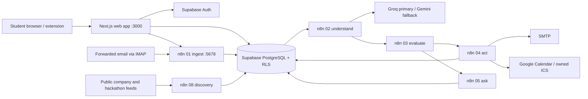

# OpportunityOS architecture

_Codebase map, 18 October 2026. Read this with [STACK.md](STACK.md). The implementation and latest migrations take precedence over older pitch documents._

## What the system does

OpportunityOS collects student opportunities, extracts source-backed facts, compares them with a student profile, and records one of three decisions: `ACT`, `ASK`, or `IGNORE`. `ACT` can update tracking, prepare tasks and calendar files, send opted-in notifications, and, for the configured demo account, write to a separate Google Calendar. `ASK` requires a student decision. The system never submits an application for the student.

## Runtime topology

The website and n8n run locally. Authentication, PostgreSQL, and private resume storage are in Supabase. The local website therefore still needs network access for signed-in data. Docker Compose binds the n8n editor to `127.0.0.1:5678` and persists n8n data in a named volume. A gateway/quick tunnel can expose selected webhooks; it is not dependable hosting for the website.

## Source tree and ownership

| Path | Responsibility |
|---|---|
| `web/src/app` | Next.js pages, route handlers, and server actions. Workspace layout requires an authenticated user. |
| `web/src/components` | Opportunity cards, decisions, approvals, onboarding, activity, and navigation UI. |
| `web/src/lib` | Supabase clients, validation, profile/resume helpers, application contracts. |
| `extension` | Manifest V3 browser capture with popup, content script, and background worker. |
| `scripts/generate-*-workflow.mjs` | Source of the portable n8n workflow exports and credential-bound runtime copies. |
| `workflows` | Sanitized n8n JSON exports; credential secrets live in n8n, not here. |
| `scripts/*-contract.mjs` | Reusable pure logic embedded in n8n Code nodes and tested with Node. |
| `supabase/migrations` | Ordered schema, RLS, triggers, worker RPCs, and later repairs. Current source reaches `0072`. |
| `supabase/tests`, `scripts/*.test.mjs` | SQL ownership/policy checks and Node contract tests. |
| `config` | AI prompts, structured output schemas, and observed free-tier quota configuration. |

## Workflow and web entry points

| Entry point | Role |
|---|---|
| `01-ingest` | Authenticated webhook for raw submissions; hashes and saves a durable owned item. |
| `02-understand` | Queue worker for source preparation, extraction and provenance. |
| `03-evaluate` | Queue worker for eligibility, matching evidence and code decisions. |
| `04-act` | Durable tracker/task/calendar/notification actions. |
| `05-ask-and-approve` | Human approval and clarification workflow. |
| `06-autopilot` | Scheduled follow-up and recovery orchestration. |
| `07-error-handler` | Controlled workflow error recording. |
| `08-discovery` | Configured public feed scans and catalog projection. |
| `09-plan` | Historical export; the weekly plan feature is retired in the current web app. |
| `10-resume` | Resume/profile workflow support. |
| `/api/intake`, `/api/capture/*` | Authenticated submission and browser capture boundary. |
| `/api/resume/*` | Private PDF upload, draft and confirmation boundary. |
| `/api/calendar/[id]` | Authenticated owned `.ics` download. |
| `/api/plan/*` | Explicit `410 FEATURE_RETIRED`. |

## Main data journey

1. **Capture:** A signed-in student pastes text/URL, uses the browser extension/bookmarklet, or forwards an alert. `/api/intake` checks origin, session, payload shape and size; captured browser submissions also require a single-use nonce and SHA-256 payload binding. The request goes to the authenticated `01-ingest` webhook. `08-discovery` scans configured public feeds every 15 minutes and projects catalog entries to relevant users.
2. **Store and deduplicate:** `raw_items` preserves the original submission. Content hashes, source links, fingerprints, and catalog records avoid repeated analysis and duplicate cards. PostgreSQL functions own the queue and write boundaries.
3. **Understand:** `02-understand` claims one item, safely reads a public page if needed, cleans/chunks long text, consults cached extraction, reserves AI budget, then asks Groq with Gemini fallback for structured facts. `understand-contract.mjs`, `skill-extractor.mjs`, and the JSON schema validate fields and require literal source evidence. Invalid/uncertain results fail visibly. `opportunities`, `opportunity_sources`, and `opportunity_requirements` hold validated output.
4. **Evaluate:** A database trigger queues evaluation when an opportunity or profile materially changes. `03-evaluate` calculates hard eligibility in code, asks AI only for bounded matching evidence when needed, checks quotations against both opportunity and profile, then computes the 0–100 score and `ACT`/`ASK`/`IGNORE` in `decision-contract.mjs`. The decision and policy version are stored in `matches`.
5. **Act or ask:** `ACT` invokes `04-act`; `ASK` invokes `05-ask-and-approve`. The database checks the match revision, eligibility, trust tier, deadline, consent, and approval before queuing an action. Actions have stable idempotency keys, claim tokens, recoverable leases, and recorded outcomes. The approval path is fenced against stale or `UNKNOWN` matches.
6. **Show results:** Signed-in pages read owned rows through Supabase RLS: inbox, opportunities, approvals, applications, rules, activity, sources, and profile. Realtime plus polling refreshes visible progress.

## Decision rules

- Hard eligibility has `ELIGIBLE`, `INELIGIBLE`, or `UNKNOWN`. Missing or contradictory mandatory facts stay `UNKNOWN`; expired deadlines are not actionable. A deadline of today without a verified closing time is treated conservatively.
- Score weights are skill fit **40**, career alignment **20**, interest fit **15**, location fit **10**, profile fit **10**, urgency **5**. Cautious mode requires score/confidence `80/0.85`, balanced `70/0.75`, autopilot `60/0.65` before autonomous `ACT`.
- Hackathon checks focus on participation rules and submission deadline; academic degree/CGPA requirements do not disqualify hackathon participants. Jobs and internships use relevant stated constraints. A job/internship with no stated deadline can receive low-risk tracking/notification but no fabricated calendar event.
- `corroborated` sources can reach the full action path when other gates pass. `attributed` sources are limited to low-risk tracking/email actions. `unverified` or risk-flagged sources are blocked from automatic actions.
- AI supplies extraction and matching evidence. It cannot authorize an application, decide policy by itself, or override SQL action guards.

## Calendar, email, and resume

- Calendar consent is stored separately from email consent. `worker_action_allowed` permits a direct `calendar_event` only for the UUID in private `demo_user_id` **and** an opted-in profile. Others can receive an owned `.ics` file. The configured account is currently the presenter's OpportunityOS login; the Google credential points to a separate demo calendar under the agent Google account. The OAuth credential currently reports that it must be reconnected, so a fresh provider write has not been verified.
- The Calendar action first reads an event by deterministic ID. A confirmed 404 allows creation; an existing event is updated; an uncertain read fails instead of risking duplicates. Events are private, labelled `[DEMO TEST]`, and have no attendees/invitation updates.
- Notification email uses n8n SMTP. SMTP acceptance is recorded separately from inbox delivery. Incoming forwarded alerts use IMAP. Consent and recipient selection are enforced in the worker context.
- `/api/resume/upload` accepts an authenticated extractable PDF, max **5 MiB** and **10 pages**. It rejects image-only PDFs, proposes education, skills, experience and projects from text, and stores a private draft for student confirmation. Confirming the profile removes the stored PDF. The resume extraction never silently overwrites confirmed profile facts.

## Database design and safety

Core owner-scoped tables include `profiles`, `profile_skills`, `profile_projects`, `raw_items`, `opportunities`, `opportunity_sources`, `opportunity_requirements`, `matches`, `applications`, `actions`, `approvals`, `clarifications`, `standing_rules`, and `events`. Private tables contain source registry/catalog, execution ownership, action payload state and settings. Supabase Auth owns identities; RLS gives students their own rows. Server actions/RPCs check `auth.uid()` and user ownership. Worker-only functions are not granted to ordinary authenticated clients.

State-changing workers use leases, revision numbers and idempotency keys so stale results cannot overwrite a newer profile/opportunity decision. Calendar retries reuse a stable event ID. Email delivery uncertainty is not blindly retried. Source URL fetching validates DNS/redirect targets and blocks private/local addresses; source text is treated as untrusted data, including prompt-like instructions.

## Current operating state and limits

- The last recorded stabilization pass on 18 October had **252/252 Node tests**, lint, TypeScript, production build, **8/8 smoke checks**, a primary acceptance script, and an authenticated fictional intake pass. These are historical checks, not proof of every future provider response.
- The website and n8n were both returning HTTP 200 in the latest local check. Direct Calendar is presently blocked by an expired/revoked n8n OAuth connection pending human reconnection. Fresh email inbox delivery has not been independently rechecked for this demo. A stable public website deployment has not been established.
- There is no presently eligible, future-dated corroborated match on the presenter account to trigger a live Calendar action; use a clearly labelled fictional fixture for the full integration rehearsal. Never present seeded fixtures as organic discovery.
- The old weekly planner remains in history, but `/plan` redirects to `/applications` and `/api/plan/*` returns `410 FEATURE_RETIRED`. Older demo scripts describing a live weekly plan are stale.
- The README's Next.js 15 and Gemini 2.5 labels are stale relative to installed `next@16.4.0` and `config/ai-quota.json` (`models/gemini-3.5-flash-lite`). Check code and live credentials before naming a model on stage.

## Verification and operations

Use `scripts/start-website.ps1` for the local production build, Docker Compose for n8n, and the project deployment scripts for the generated workflows. `scripts/run-database.ps1` applies reviewed SQL through the configured n8n Postgres credential. `scripts/smoke-tests.mjs`, `scripts/test-primary-acceptance-journey.mjs`, Node contract tests, SQL tests, lint, TypeScript, and the Next.js build cover different boundaries. See `docs/progress.md` for dated evidence; do not confuse unit fixtures with an uninterrupted live provider call.
