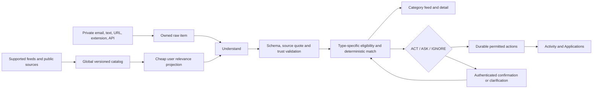

# OpportunityOS — Product Recovery and Expansion PRD

**Version:** 1.0 · **Date:** 17 October 2026 · **Status:** implementation guide, not a completion claim

This PRD records the owner's decisions after the first mentor evaluation. It supersedes the earlier next-phase guide where scope conflicts: internships, jobs, and hackathons are the active categories; scholarship and program profile choices are removed; the Weekly Plan feature is retired; verified opportunity understanding and useful actions take priority over feature count. Preserve the original project's $0 development constraint and security boundaries unless the owner explicitly changes them. Do not treat this document as evidence that a feature is deployed or working.

## 1. Product goal

A new student can upload a resume, review a mostly complete profile, choose trusted opportunity sources and notification options, and receive a relevant, ranked internship/job/hackathon feed. For each listing, OpportunityOS explains the opportunity, extracts actual stated requirements and skills, compares them with confirmed profile facts, calculates an intelligible match score, recommends preparation, and tracks the student's next step. It automatically performs only permitted low-risk actions and asks for confirmation where required. Email, calendar, approvals, and reminders report their real outcomes.

**Primary acceptance journey:** A genuine internship with explicitly stated Python and React requirements enters from a supported source or browser capture. The source text visibly contains those requirements. The saved requirement records contain them with matching quotes and mandatory/preferred classification. The student profile contains Python but not React. The detail page shows Python matched, React as a skill gap, a reproducible score, a concise summary, and preparation advice. The listing appears in the Internship tab in correct rank order. Saving and marking Applied persist after refresh; a verified deadline creates the calendar/reminder effects only after the student has opted in and connected a calendar. Every step has traceable database and n8n identifiers.

**Non-goals:** automatic application submission; impersonating a student; guessing absent deadlines or qualifications; trusting an arbitrary email, page, extension payload, or AI statement as proof of employer authenticity; an alleged employer ATS score; direct scraping of login-gated or disallowed portals; guaranteeing email inbox placement. A quick-tunnel URL is not a dependable public deployment.

## 2. Current baseline and repair targets

At planning time the repository is at commit `359232d` with an unrelated untracked `docs/mentor-round-brief.md`; preserve it. Recheck baseline before implementation. The website uses Next.js 16.4, React 19, TypeScript, Tailwind, Supabase and n8n. Migrations reach `0061_resume_first_profile_confirmation.sql`; allocate later migration numbers only after checking the directory. Exported workflows include `01` through `10`. Earlier reports say several workflows were deployed, but the implementing agent must compare exports to **active** n8n versions and run live journeys before claiming success.

Known gaps to investigate, not assumed root causes:

- Listings visibly contain required skills in a description while the detail view has empty `opportunity_requirements`, so deterministic eligibility becomes UNKNOWN and the queue fills with ASK/source-review items. Trace source response → normalized item → catalog → owned opportunity → requirements → evaluation claim → UI. Do not lower the UNKNOWN safety gate to hide a broken handoff.
- Real forwarded internship emails have failed source-evidence validation. Reproduce with a controlled, attributed message and inspect the exact quote/cleaning mismatch before changing validation.
- The direct Google Calendar write is limited to the connected demo account. Other users currently need links/ICS or a separately authorised per-user OAuth integration. Notification and reminder delivery must be checked against action records, not inferred from queued actions.
- Resume intake extracts some academic fields and skills but currently requires the student to assign new skill levels. Profile does not model projects/GitHub evidence or years of professional experience separately.
- The catalog has a type filter and some ranking, but the user wants three distinct destinations. The Weekly Plan is in navigation and workflow `09` and must be retired without breaking reminder/calendar logic.
- Existing labels “Standing Rules” and “Autonomy Ledger” are opaque to students.

## 3. Experience and functional requirements

### 3.1 Sign-up, onboarding and consent

After email confirmation, present a short setup flow: upload a text PDF resume or complete key facts manually; review proposed profile facts; choose opportunity types and currently supported source groups; set preferred locations; select notification preference; optionally connect Google Calendar. Keep every choice editable in Settings/Profile. Do not block signup when a resume or calendar is unavailable.

`P-01` Remove Scholarship and Program from active interest choices, filters, and new-student defaults. Preserve historic rows without destructive deletion; hide or mark old types unsupported rather than silently changing their meaning.

`P-02` Add projects as repeatable records: title, short description, technologies, optional public GitHub URL, dates if actually known, source (resume/manual/GitHub), and owner. Add a separate optional years-of-professional-experience field. Do **not** calculate employment years by counting projects.

`P-03` Resume processing proposes every supported field it can substantiate: name, degree, branch, academic/graduation year, CGPA with scale, skills, projects, links, and professional experience. Each proposal has an exact resume quote/page or is labelled as an unverified suggestion. The student reviews one draft and confirms selected values atomically. Preserve current values unless the student explicitly replaces them. A profile revision fences stale drafts; confirming a profile triggers owned opportunity reevaluation and new-user catalog catch-up.

`P-04` AI may suggest Beginner/Intermediate/Advanced skill levels from repeated use, project scope, duration and explicit self-description. Each level includes evidence and confidence. Missing evidence leaves level unset. The student can accept/edit/remove suggested levels; no inferred level becomes a verified profile fact without confirmation. Keep a distinction between a skill mentioned and a demonstrated skill.

`P-05` Ask separately for (a) OpportunityOS emails/reminders and (b) permission to create/update events on a connected Google Calendar. Both default off for a new user, record consent time/scope, and can be revoked. Calendar connection uses per-user OAuth and the narrowest required scope; credentials/tokens stay server-side and encrypted. If consent or connection is absent, offer a calendar link/ICS for verified deadlines and never report a direct write as done. The existing demo-account path stays explicitly labelled as a demo until replaced.

### 3.2 Source intake, coverage and trust

`S-01` Maintain one versioned source-item contract for public feeds, pasted text, URL intake, forwarded email, extension/bookmarklet capture, and authenticated API calls. Server/worker derives ownership; clients cannot set trust, verification, action policy or owner. Save raw text, final URL, capture time, content hash, source attribution and fetch/capture method before analysis. Cache duplicate public content before AI calls. Keep private email/capture content owner-scoped.

`S-02` Discovery runs on the configured schedule and produces a bounded global catalog. Relevance projection for each student starts with cheap category, location, field/seniority and source-preference filters. Do not spend an AI call on obviously unrelated or duplicate listings. New profiles receive matching existing catalog records without waiting for tomorrow's scan. Source scan health shows last successful scan, next due scan, item counts and errors. Confirm the actual active schedule and due-source cadence; do not equate a trigger firing with a source scan succeeding.

`S-03` On onboarding, offer only connected/supported source groups. For a new source, show a bounded sample of relevant listings under “New source to review” and ask once whether the student wants future items. Following a source is a preference, **not** employer verification. Source trust still comes from publisher/URL evidence and risk checks. Students can mute or hide sources and listings. No repeated approval card per listing merely because its source is new.

`S-04` Audit AICTE, Internshala, Commudle and MLH independently for a permitted, stable feed/API or alert route, robots/terms, provenance, listing fields and update cadence. Implement at most two validated adapters first. If direct automation is not permitted or reliable, use alert forwarding or deliberate extension capture and say so. Do not claim source integration because a page can be opened manually.

`S-05` The extension and API send one authenticated captured listing. The extension previews title/text/URL/time; nonce and origin binding prevent replay or ownership forgery. The server saves quickly and returns a processing ID. n8n analyses the particular captured text or safely fetches the public listing page; it does not browse an entire site autonomously. Dynamic/login pages use user-visible captured text. Captured content stays unverified until source checks pass.

### 3.3 Understanding, eligibility and ranking

`U-01` Normalize source text without discarding qualifications sections. Prefer structured provider fields and deterministic extraction for explicit facts; use AI structured extraction for messy prose or missing fields. Define a fixed schema with `title`, `employer`, `opportunity_type`, `description`, `deadline`, `location`, `application_url`, `required_skills`, `preferred_skills`, `mandatory_eligibility`, `other_requirements`, `benefits`, and evidence quote/span per claim. Extracted facts are proposals until schema, quote, type and date validation passes. Invalid output leaves a retryable visible failure or partial card; never a successful empty requirements set when the original text has not been examined.

`U-02` Prove the same requirements flow through catalog and private intake. Preserve all exact quotes and field provenance. For a listing with text but empty requirements, classify it explicitly as `NO_REQUIREMENTS_STATED`, `EXTRACTION_INCOMPLETE`, or `REQUIREMENTS_PRESENT` according to evidence. `EXTRACTION_INCOMPLETE` is a pipeline error/retry path; do not present it as a student's unknown eligibility question.

`D-01` Use type-specific policy. Internships and jobs evaluate only stated mandatory facts (such as student status, degree, graduation year, location/work authorisation, experience or a truly mandatory skill). Preferred skills affect matching but do not hard-fail eligibility. The absence of a criterion does not mean the student fails it. Hackathons check only stated participation rules, such as age, region, team size, student status and verified registration/submission deadline; do not force internship academic criteria on them. A missing deadline permits a listing to be shown/saved but never an invented calendar entry. Expired or explicitly ineligible items cannot ACT.

`D-02` AI proposes semantic matching evidence but deterministic code computes the score, confidence and ACT/ASK/IGNORE decision. Retain or intentionally version the current weights (40 skill, 20 career, 15 interest, 10 location, 10 profile, 5 urgency) and mode thresholds; publish any change with fixture comparisons. Required-skill coverage and preferred-skill coverage are displayed separately. Null/unknown components remain null with a coverage indicator rather than being quietly scored as zero. Show a numeric score only when sufficient verified inputs exist; otherwise show “Not enough verified information to score.”

`D-03` Rank each category by eligible/relevant match, then tie-break by confirmed deadline and recency; allow user-selected Best match, Newest and Deadline soonest. Sorting must happen in the database before pagination so page two can contain a higher-scoring item only if the user has explicitly selected a different sort. Hide unrelated fields without deleting their source records. Maintain diversity caps so one employer/source does not fill the first page.

### 3.4 Student-facing detail, applications and insight

`X-01` Separate top-level Internship, Job and Hackathon views or tabs while reusing one underlying catalog and shared filters. Each card shows type, employer, trust, deadline or “not stated,” match state/score, and Saved/To Apply/Applied status. Preserve deep links and category filters on reload/mobile.

`X-02` The detail page shows a concise generated summary, “What you would do,” required and preferred skills, other requirements, known eligibility checks, matched skills, missing skills, why the score was assigned, and a Preparation section. Preparation distinguishes source-stated skills from optional study suggestions; it does not invent employer interview stages. Keep an Open original listing link and collapse source quotes under “Why this decision?” rather than removing provenance.

`X-03` Students can save, hide, mark Not interested, and manually mark Applied. Off-site application submission is not observable by default; never infer Applied from clicking an external link. The Applications view groups current stages and allows explicit updates. Preserve previous status and action history.

`X-04` Rename Standing Rules to “Your automation preferences” and Autonomy Ledger to “What the agent did.” Explain a rule as “After you repeatedly approve similar safe actions, OpportunityOS can suggest doing those actions automatically next time.” Show scope, example, last use, edit/revoke control, and plain-language activity. Three distinct consistent explicit decisions may produce a **proposal**, never automatic activation. Rules cannot bypass eligibility, source trust, consent or action limits.

`X-05` Skill gaps show missing skills from the student's relevant verified listings, prioritised by frequency and importance. “Trending” requires a defined source cohort and time window, displayed with counts and coverage limits. Resume-to-role feedback can compare resume evidence with stated role requirements, but must not present an invented employer ATS pass probability or opaque “ATS score.”

`X-06` Add an optional “Resume fit for this role” review after requirement extraction is reliable. Compare confirmed resume/profile evidence to the verified listing, report covered and missing required/preferred terms, readability/section issues that can be measured, and concrete edits the student can accept or reject. A transparent coverage percentage may be shown with its formula and missing-data caveat. Do not imply an employer's proprietary ATS would pass or reject the resume. Store a versioned review tied to the particular resume and listing revisions; never expose the private resume through shared catalog records.

### 3.5 Actions, approvals, notifications and deployment

`A-01` Explain ACT in the product: automatically save/track, create a task, notify, schedule a permitted follow-up, or create a verified deadline event only with proper consent and trust. It never submits applications. Each action has queued/processing/done/failed/uncertain state; UI success follows recorded result, not an HTTP request that only queued work.

`A-02` Separate an **eligible action approval** from **missing-information/source review**. Only eligible ASK can be approved. The website confirmation checks owner, current revision, expiry, replay, source/trust and action policy before resuming the private n8n Wait execution once. A profile correction reevaluates all affected opportunities. Approval notifications include an authenticated confirmation-page link, not a browser-visible Wait URL. A stable public HTTPS origin is required for links to work from a different device; a Gmail message cannot safely grant approval merely by being opened or clicked without authentication and CSRF/replay protection.

`A-03` Audit the full calendar path: known deadline → eligible/trusted action → consent and connected account → durable claim → Google Calendar result or link fallback → recorded event ID → user-visible status. Reconcile uncertain results by stable event ID. Test the demo account and a separately connected test user; do not claim all users receive direct writes while only the demo credential exists.

`A-04` Audit reminder path from notification preference and confirmed deadline to queued reminder, n8n send, provider result and recipient inbox. Respect opt-out, local-time display and idempotency. Record uncertain delivery for review instead of blindly resending. Keep in-app activity as fallback; no promise that every provider places mail in Inbox. For a future custom sending domain, configure SPF/DKIM/DMARC and measure delivery. Direct per-user Gmail reading through OAuth is a separate, consented phase because mailbox read scopes and verification are materially different from forwarding.

`A-05` Retire Weekly Plan end to end: remove navigation, pages/API access or redirect them to a relevant destination, disable/archive workflow `09-plan`, stop its schedule/triggers, and remove planner-specific notifications. First trace dependencies so deadline reminders, follow-ups, tasks and calendar actions continue to work. Preserve existing plan data for recovery; no destructive migration in this release. Remove Weekly Plan claims from current UI/demo docs after retirement.

`A-06` Offer optional “Connect Gmail to find opportunity alerts” after the forwarded-email route is reliable. OAuth permission and inbox filtering are separate from Google Calendar consent. Read only the minimum message scope and selected labels/query needed; show what will be accessed and let the student revoke access. Ingest sender, message ID, subject/body and provider authentication metadata through the same private source-item contract, dedupe by mailbox and message ID, and never read another user's mailbox. Keep forwarding available. Evaluate Google restricted-scope verification and production readiness before claiming this can serve arbitrary public users; consider Outlook only after the Gmail route is proven. This feature does not authorise sending or deleting a student's mail.

## 4. Architecture contracts

Keep existing ownership and worker boundaries: Next.js authenticates, validates and presents; Supabase holds owner-scoped records, global private catalog, queues, RLS and atomic revisions; n8n visibly orchestrates extraction, evaluation, actions and errors; AI has no authority to write decisions or external effects. Reuse shared deterministic `scripts/` contracts inside n8n Code nodes and tests. The frontend must not grow an independent policy implementation. Every workflow export is generated reproducibly, compared with the deployed active workflow, and stripped of secrets.

Proposed data changes (reconcile exact names with current schema before migration): `profile_projects` and `profile_consents`; versioned `extracted_facts` or existing opportunity/requirement extensions with `requirement_class`, quote and status; `source_preferences` if existing subscriptions cannot hold the new follow/mute state; `listing_summaries` with source hash/model/prompt version; per-user `calendar_connections` in a server-private/token vault boundary; optional `skill_gap_snapshots` keyed to profile and listing revisions. Add ownership constraints, RLS, revocation and backfills. Never put OAuth refresh tokens, resume content, service keys or private n8n Wait URLs in browser-readable tables.

## 5. Delivery phases and gates

### Phase 0 — Baseline and reproduction

**Goal:** establish actual deployed state and reproduce the reported failures before changing policy.

**Files/areas:** `docs/progress.md`, `scripts/generate-{discovery,understand,evaluate,act,autopilot}-workflow.mjs`, `workflows/{01,02,03,04,05,06,08,09,10}-*.json`, latest migrations, `web/src/app/(workspace)/opportunities/[id]/page.tsx`.

**Work:** Record Git state, services, active workflow IDs/versions, applied migrations and config names. Trace at least three real listings: one company job whose description states skills, one internship email that failed evidence, and one hackathon. Capture raw/normalized text, extraction output, persisted requirements, evaluation snapshot, match, action, and UI in a private test report. Confirm calendar/reminder conditions and outcomes. Identify whether failures originate in extraction, normalization, persistence, projection, evaluation or display. Preserve unrelated data.

**Gate:** Every reported symptom has either a reproducible root-cause boundary with record/execution IDs or is explicitly UNVERIFIED with a precise missing prerequisite. No policy loosening and no new feature before this gate.

### Phase 1 — Correct understanding and decisions

**Goal:** real listings with stated requirements produce correct requirements, eligibility, score and explanation.

**Files/areas:** `scripts/discovery-adapters.mjs`, `scripts/skill-extractor.mjs`, `scripts/understand-contract.mjs`, `scripts/decision-contract.mjs`, workflow generators `02/03/08`, corresponding exports, one cohesive migration after `0061`, SQL/Node fixture tests, listing detail UI.

**Work:** Repair the exact broken handoffs from Phase 0. Version the extraction schema and type policies. Add source quote validation, extraction-incomplete error, mandatory/preferred/other separation, category-specific eligibility, score coverage and fresh reevaluation on source/profile changes. Keep expensive AI calls behind dedupe and cheap relevance filters. Preserve trust/action gates.

**Gate:** Ten guide scenarios plus real company job, internship email and hackathon produce verified facts and decisions. A description stating required Python/React cannot save zero requirements. An absent criterion is not treated as a failed criterion. Unsupported AI output is visible and retryable. UNKNOWN cannot ACT or be approved. Live n8n execution and UI records agree after refresh.

### Phase 2 — Resume-led onboarding and consent

**Goal:** a new student can establish an accurate profile without manually entering each skill and can control notifications/calendar separately.

**Files/areas:** `web/src/components/resume-onboarding-card.tsx`, `web/src/lib/resume.ts`, `scripts/resume-contract.mjs`, `web/src/app/api/resume/*`, `web/src/app/(workspace)/profile/*`, `web/src/lib/profile-utils.ts`, `web/src/lib/types.ts`, owned migrations/RLS tests, OAuth connection UI/API.

**Work:** Extend draft schema to projects, links and suggested skill levels with confidence/evidence. Implement atomic confirmed merge, revision handling, and catalog catch-up. Add separate opt-ins and revocation. Connect per-user Calendar only through reviewed server-side OAuth, otherwise show link/ICS. Keep sensitive PDFs private and apply existing deletion policy.

**Gate:** New user uploads a text PDF, reviews all proposals once, corrects one skill level, confirms, sees fields/projects saved after sign-out/in, and receives appropriate listings. A second user cannot access the draft or calendar token. Declining email/calendar causes no direct sends/writes. Revocation stops future effects.

### Phase 3 — Focused catalog, student actions and Weekly Plan retirement

**Goal:** the first page is relevant, readable, and divided into distinct opportunity types.

**Files/areas:** `web/src/app/(workspace)/opportunities/*`, `web/src/app/(workspace)/inbox/inbox-feed.tsx`, `web/src/app/(workspace)/applications/*`, `web/src/app/(workspace)/sources/*`, relevant catalog query RPC migration and tests, `web/src/app/(workspace)/rules/*`, navigation and plan routes/components/API, `scripts/generate-plan-workflow.mjs`, `workflows/09-plan.json`, active n8n workflow and demo/runbook docs.

**Work:** Three category tabs, server-side rank/sort/filter before pagination, diversity caps, source follow/mute, source review, applied status and clear rule/activity labels. Keep original URL and collapsed quote details. Add accessible empty/loading states and mobile layout. Inventory planner dependencies, preserve shared reminder/calendar utilities, archive/disable the deployed `09-plan` workflow, remove its active triggers and current navigation/API entry points, redirect old links, preserve historic plan rows, and remove current Weekly Plan claims from product/demo docs.

**Gate:** With >50 mixed listings and two different student profiles, each tab contains only its type; high relevant matches appear first under Best match; filters/sort persist across pages and refresh; applying/hiding/muting survives sign-in; no cross-user leakage; a new source prompts once rather than creating dozens of unapprovable cards. Weekly Plan is absent from navigation and no active plan workflow runs; existing tasks, reminders and calendar links still work, and historic data remains recoverable.

### Phase 4 — Actions, email and calendar reliability

**Goal:** the claimed automated effects have verifiable external outcomes and accessible approval links.

**Files/areas:** `scripts/actions-contract.mjs`, `scripts/generate-{act,ask,autopilot,error}-workflow.mjs`, `workflows/{04,05,06,07}-*.json`, approval route/actions, consent records, server-only calendar/OAuth bridge, deployment config/runbook.

**Work:** Repair observed calendar/reminder failures, add per-user consent/connection checks, reconcile uncertain effects, prove mailbox receipt, and deploy a stable HTTPS web origin for authenticated confirmation. Preserve private Wait bindings. Do not increase email/calendar test limits without fresh authorisation.

**Gate:** Controlled eligible ACT creates exactly one permitted task/tracker effect, a calendar event only for a consented connected test user, and an actual reminder email only when opted in. Eligible ASK email opens the deployed authenticated page and resumes exactly one waiting execution; rejection/expiry/replay/cross-user attempts fail safely. Delivery failures are visible as failed/uncertain, not successful.

### Phase 5 — Listing summary, preparation and carefully expanded sources

**Goal:** each relevant card helps the student decide what to learn and do next, without fabricated advice or unverified feeds.

**Files/areas:** versioned summary/preparation contract and cache, listing detail UI, source adapters/registry, source feasibility register, tests.

**Work:** Generate concise grounded summaries and separate source-stated requirements from optional preparation. Derive skill gaps and transparent demand counts from relevant current listings. Add versioned resume-to-role feedback with a disclosed coverage formula and no employer-ATS claim. Validate AICTE/Internshala/Commudle/MLH access and implement up to two reliable permitted sources. As a separate subphase after the core gate, research and implement per-user Gmail read-only OAuth only if verification, privacy and $0 operation are feasible; otherwise retain forwarding and mark direct mailbox access deferred. Never silently treat a proposed integration as delivered.

**Gate:** Five diverse real listings show accurate summaries, quoted required skills, non-fabricated optional preparation and correct gap math. Resume fit reports match its published formula and hide private resume text from other users. Each newly claimed source completes repeated permitted scans, dedupes, reports health and produces relevant owned cards. An unsupported source is clearly labelled capture/forwarding-only. If Gmail OAuth ships, a connected test mailbox imports only selected opportunity alerts, dedupes them, survives token refresh, blocks cross-user access and stops on revocation; otherwise the UI does not offer it as working.

### Phase 6 — Full regression and release readiness

**Goal:** prove that all connected product journeys work together after the preceding changes.

**Files/areas:** affected workflows and generators, app routes, migrations, integration/permission tests, `docs/progress.md`, deployment and recovery runbook.

**Work:** Run clean two-user journeys from onboarding through discovery/capture/email, verified understanding, category ranking, ACT/ASK, external effects, application tracking, insight and revocation. Inspect active workflows, source health, mail/calendar delivery, private data boundaries, errors and performance. Repair any regression before release, then record exact evidence and limitations in the runbook.

**Gate:** All seven release conditions in Section 6 pass with fresh live traces. No critical unresolved defect remains in the primary acceptance journey. Any unsupported integration is accurately labelled and cannot produce a false success state.

## 6. Test strategy and release definition

### Requirement traceability

| Phase | Requirements | Minimum live proof |
| --- | --- | --- |
| 0 | Baseline for all IDs | Three reported failures traced to a specific boundary or explicitly unverified |
| 1 | `U-01–02`, `D-01–03`, relevant `S-01–02` | Real description with stated skills produces owned requirement rows and a correct decision |
| 2 | `P-01–05`, `A-03` consent portion | Resume draft confirmed; both opt-outs and a connected test calendar behave correctly |
| 3 | `S-03`, `X-01`, `X-03–04`, `A-05` | Category-pure ranked feed, source preference, applied status, no active Weekly Plan |
| 4 | `A-01–04`, approval part of `D-01` | ACT/ASK, real email/calendar result, expiry/replay and revocation |
| 5 | `S-04–05`, `X-02`, `X-05–06`, optional `A-06` | Grounded summaries/gaps, permitted source scans and optional proven Gmail connection |
| 6 | All IDs and cross-boundary controls | Fresh two-user end-to-end regression and recorded limitations |

For every phase run affected Node contract tests, workflow generation/validation, SQL ownership tests, TypeScript, lint and production build. These are **necessary but insufficient**. Separately run live browser/integration journeys through website → auth → n8n → Supabase → AI/policy → external action → refreshed website. Record trace IDs, elapsed time, source and type, profile revision, workflow execution ID, database IDs and actual external result. Label fixtures, seed rows and simulated provider responses. Repeat with two users and at least one failure path. Test desktop/mobile with realistic catalog volume.

Security regression: unsafe URL/redirect, forged owner/trust fields, prompt injection, conflicting source facts, invalid AI JSON, false evidence quotes, duplicate/concurrent intake, stale profile/approval revisions, cross-user reads and writes, unknown eligibility approval, consent revocation, quota exhaustion, uncertain email/calendar result. No source text may change system instructions; no failed integration may appear green.

Performance targets for this release: authenticated catalog first page should remain responsive with >50 owned listings; capture/intake acknowledges promptly and processes asynchronously; no page waits synchronously for an LLM; record p50/p95 observed times rather than promise an unmeasured number. Monitor processing age and error rate by stage. A slow or unavailable model leaves a retained item and visible status.

**Release is accepted only when:**

1. The primary acceptance journey at the top of this PRD passes fresh, without manual database insertion substituting for source intake.
2. A second user independently completes onboarding and sees only owned projections/actions.
3. Internship, Job and Hackathon type-specific fixtures and real samples pass; no stated requirement disappears before evaluation.
4. Calendar, email, approval and follow-up outcomes match actual provider/n8n/database state, with opt-outs and uncertain results honored.
5. The first page is relevant, diverse and category-pure; sorting/pagination are correct.
6. Weekly Plan is retired without breaking the above.
7. Active workflows match reviewed secret-free generated exports; runbook and current progress log report any remaining limitations honestly.

## 7. Implementation constraints and human setup

The builder should complete code, migrations, workflow generators, tests, deployment preparation and reversible local checks autonomously within existing authority. The student may need to complete provider OAuth consent, connect a personal test calendar, choose a permanent HTTPS hosting option/domain, and supply a separate recipient inbox for delivery observation. Ask for exact external sends or deployment permissions only when genuinely required; prepare a concrete reviewed change first. Do not request passwords or tokens in chat.

For Gmail direct mailbox access, investigate OAuth scope and verification obligations before implementing; forwarding and extension capture remain operational choices. For custom-domain delivery, follow current provider authentication guidance and verify inbox placement empirically. For candidate sources, record permission, format stability, pagination, rate limits and sample listing quality before scheduling scans. $0 feasibility must be rechecked against current provider terms/quotas when each integration is built.

## 8. Suggested implementation handoff

Implement one phase at a time. At the start of each phase, inspect the active runtime and latest commit, then write a short three-task plan with exact files, action, verification and done conditions. Keep migrations data-preserving and workflow changes generator-first. After each phase, run focused tests **and** the phase's live acceptance gate, update `docs/progress.md` with evidence, and keep the main branch demonstrable. Do not mark a phase complete because its UI, migration, export or unit tests exist; the user journey must work.
